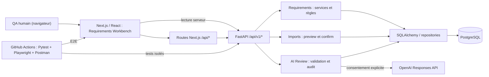
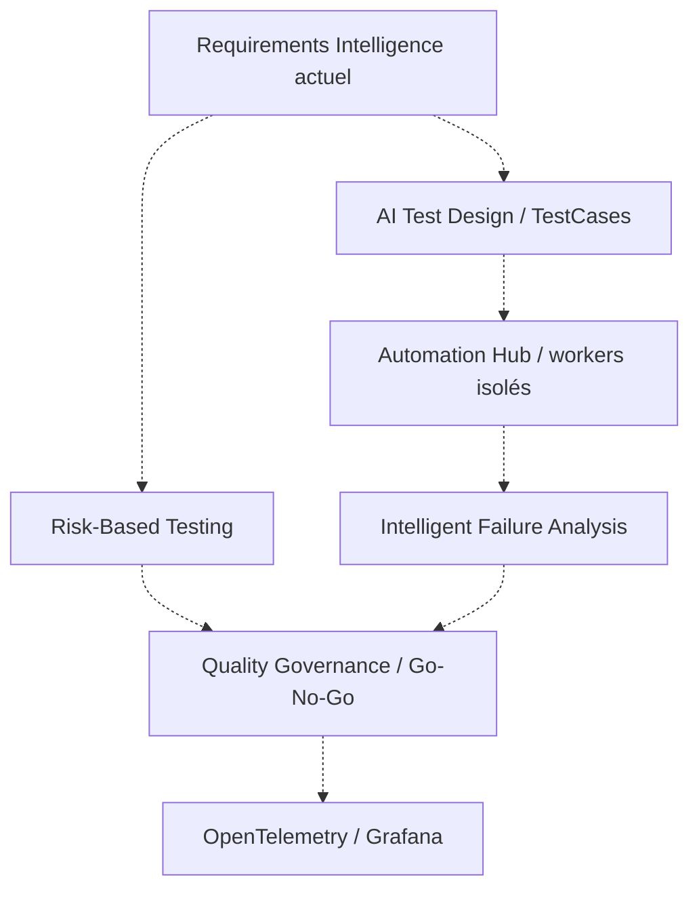

# Architecture as-built — QualityMind AI, Sprint 5

**Date :** 16 novembre 2026. **Vue :** code intégré sur `main` ; ne pas confondre avec une mise en production.

**Gouvernance :** [Produit cible et release MVP-1](https://gharbiconsulting.atlassian.net/wiki/spaces/KAN/pages/262145) · [ADR canoniques](https://gharbiconsulting.atlassian.net/wiki/spaces/KAN/pages/2129927) · [Risques et dépendances](https://gharbiconsulting.atlassian.net/wiki/spaces/KAN/pages/2195469) · [Sécurité IA](https://gharbiconsulting.atlassian.net/wiki/spaces/KAN/pages/2129964). **Status:** code intégré et CI validée, recette manuelle non signée, déploiement enterprise non autorisé.

## Diagramme des composants réellement livrés

**Base technique :** monolithe modulaire FastAPI, Next.js frontend, PostgreSQL 17, Alembic migrations, Pydantic, adaptateur OpenAI et tests CI. Aucune authentification/RBAC fonctionnelle, aucun serveur de production ni module de gestion de cas de test métier livré.

## Frontières principales

| Élément | Implémentation |
| --- | --- |
| Frontend | `frontend/src/app`, `frontend/src/components/requirements`, `frontend/src/lib/requirements.ts` |
| FastAPI | `backend/app/main.py`, `backend/app/api/v1` |
| Domaine Requirements | `backend/app/modules/requirements/{domain,application,infrastructure}` |
| Persistance | `backend/app/models`, migrations `backend/migrations/versions` |
| Provider IA | `backend/app/modules/requirements/infrastructure/openai_analyzer.py` |
| Validation IA | `backend/app/modules/requirements/application/ai_contract.py`, `ai_privacy.py` |
| QA | `backend/tests/`, `frontend/tests/e2e/`, workflows GitHub Actions |
| Documentation | `docs/functional/`, `docs/adr/`, `docs/qa/` |

## Environnements

| Environnement | PostgreSQL | FastAPI | Next.js | Usage |
| --- | --- | --- | --- | --- |
| DEV local | `qualitymind` :5432 | :8000 | :3000 | Développement |
| QA local isolé | `qualitymind_qa` :5433 | :8001 | :3001 | Recette et E2E |
| TEST intégration | `qualitymind_test` CI | Démarrage CI | Selon workflow | Tests Pytest destructifs contrôlés |

Un **test E2E QA** ne doit pas écrire dans DEV. Les tests d'intégration nécessitent `POSTGRES_DB=qualitymind_test`.

## Architecture cible non livrée

Les flèches pointillées indiquent **une trajectoire** et non des appels réseau déjà développés. Redis et workers, moteur des risques, TestCases métier, Quality Gates configurables, observabilité complète et CD restent à spécifier et livrer.
