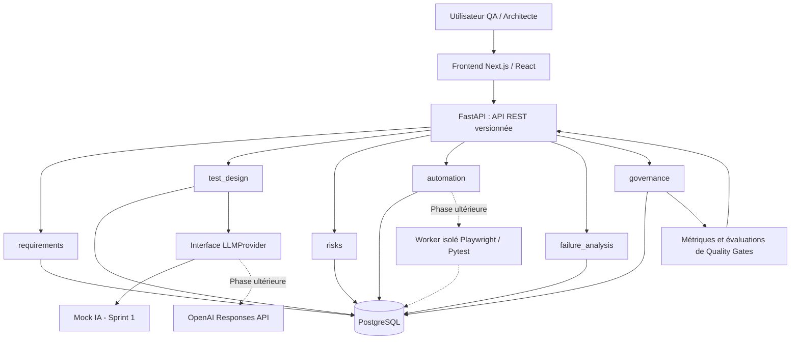
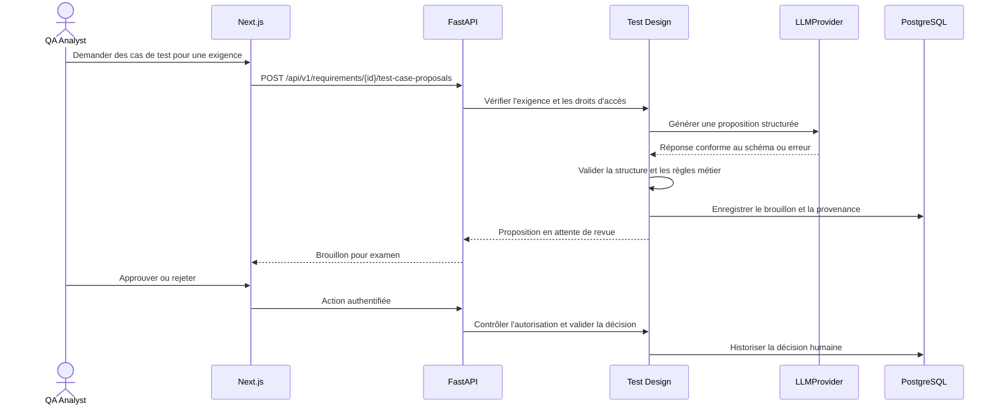

# QualityMind AI — Architecture système MVP

**Version :** 1.1 (cible + état implémenté au 9 novembre 2026)  
**Ticket :** [QA-26](https://gharbiconsulting.atlassian.net/browse/QA-26)  
**Décision associée :** [ADR-001 — Monolithe modulaire](../adr/ADR-001-modular-monolith.md)  
**Confluence :** [Architecture et décisions](https://gharbiconsulting.atlassian.net/wiki/spaces/KAN/pages/458771)

## État implémenté et périmètre cible

**Implémenté :** monolithe FastAPI et module `requirements` structuré en adaptateur HTTP `app/api/v1/requirements.py`, domaine `app/modules/requirements/domain`, service applicatif `app/modules/requirements/application`, repository SQLAlchemy `app/modules/requirements/infrastructure`, modèles PostgreSQL, migrations Alembic, schémas Pydantic, configuration CORS et DB. Endpoints en place : `GET /health`, `POST/GET /api/v1/requirements`, `GET /api/v1/requirements/{id}`. La liste renvoie `items/total/limit/offset`; entrées invalides HTTP 422 et ID absent HTTP 404.

**Vérifié :** 35 tests locaux Pytest lors de QA-64 ; Backend CI obligatoire pour PR vers `main` ; Postman Cloud CI opt-in, non requis pour la fusion. Voir QA-60–64 et QA-66–67.

**Cible seulement :** UI Next.js/React, `test_design`, `risks`, `automation`, `failure_analysis`, `governance`, intégration OpenAI, exécution Playwright, Redis/workers, observabilité complète et déploiement.

## Vue des composants



Le diagramme est **conceptuel** : les frontières de domaines décrivent des modules logiques au sein d'un seul backend FastAPI, **pas des microservices indépendants**. Les liaisons vers la base représentent des dépôts propres à chaque domaine. Les communications inter-domaines passent par des interfaces de service, sans accès direct aux tables privées des autres domaines.

## Flux d'une proposition de test assistée par IA



**Contrainte :** l'IA propose, jamais ne valide seule des tests ou une release.

## Organisation cible du dépôt

**Attention :** l'arborescence ci-dessous est une cible conceptuelle, pas une copie du dépôt. L'implémentation actuelle du module Requirements utilise `backend/app/modules/requirements/{domain,application,infrastructure}` (et non `backend/app/domains`). Les dossiers frontend, automation et évaluation restent à construire progressivement.

```text
qualitymind-ai/
├── backend/
│   ├── app/
│   │   ├── main.py
│   │   ├── api/v1/
│   │   ├── core/
│   │   ├── domains/
│   │   │   ├── requirements/
│   │   │   ├── test_design/
│   │   │   ├── risks/
│   │   │   ├── automation/
│   │   │   ├── failure_analysis/
│   │   │   └── governance/
│   │   ├── integrations/ai/
│   │   └── persistence/
│   └── tests/{unit,integration,api}/
├── frontend/src/
├── automation/{playwright,pytest}/
├── evaluation/
├── docs/{adr,architecture,qa}/
├── infra/
└── .github/workflows/
```

Les modules de domaine pourront définir `api.py`, `service.py`, `schemas.py`, `repository.py` et `models.py` suivant leur responsabilité. Éviter de créer des couches inutilisées avant d'en avoir besoin.

## Contrats, qualité, observabilité

- `GET /health` renvoie HTTP 200 et `{"status":"ok"}` pour le socle FastAPI.
- Les routes métier sont versionnées sous `/api/v1`.
- Schémas Pydantic pour les entrées/sorties, gestion explicite des HTTP 404/422 et erreurs fournisseurs.
- Décisions de Quality Gates calculées par règles déterministes sur données persistées.
- Authentification/RBAC obligatoires avant exposition multiutilisateur ; vérifications d'autorisation au niveau objet.
- Secrets hors dépôt ; journalisation structurée sans secrets, identifiant de corrélation.
- Tests Pytest pour logique et API, tests d'intégration PostgreSQL, mocks du provider IA, Playwright E2E ultérieurement.
- Les exécutions de scripts seront isolées d'un processus FastAPI pour réduire les risques.

## Diagrammes et hypothèses à revoir

1. Évaluer les contrats entre domaines au premier incrément fonctionnel.
2. Définir les migrations Alembic, contraintes de données et politiques d'historisation.
3. Préciser schémas des propositions IA, timeouts et stratégie de reprise.
4. Définir le protocole de worker et les règles d'isolation avant l'exécution de tests.
5. Compléter les menaces et les mesures d'observabilité avant déploiement.

Ce document **versionne une architecture cible** ; il ne constitue pas une preuve de déploiement ou d'exécution de composants.

## Évolution vérifiée — QA-68

- QA-60 : contrat versionné, pagination et séparation HTTP/application/persistance.
- QA-61 : CORS à origines autorisées configurables.
- QA-62 : `DATABASE_URL` prioritaire, PostgreSQL `qualitymind_test` et README reproductible.
- QA-63 : normalisation et validation des limites titre (255) / description (10 000) ; erreurs contrôlées HTTP 422.
- QA-64 : scénarios 404/422, pagination/ordre et tests d'intégration renforcés.
- QA-66 : required check GitHub `FastAPI / Pytest / PostgreSQL` et Ruleset sur `main`.
- QA-67 : Postman CLI piloté par collection cloud, variable `base_url` et activation opt-in.

Aucun de ces changements ne transforme le monolithe modulaire en microservices. L'ADR-001 reste applicable.
