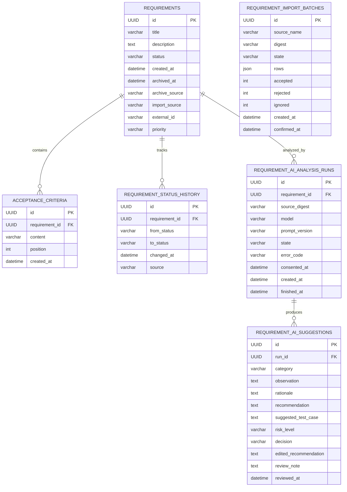

# Modèle de données et contrats — MVP Requirements Intelligence

**Source :** modèles SQLAlchemy et routes FastAPI du dépôt, 16 novembre 2026. Les champs ci-dessous sont les objets persistés réels ; aucun schéma des futurs modules de test cases/risques n'est présenté comme déployé.

## D-07 — Diagramme entité–relation

**Note :** `requirement_import_batches` conserve un snapshot de lignes dans un champ JSON, avec `requirement_id` dans chaque ligne après confirmation ; il n'existe pas de clé étrangère relationnelle vers `requirements` depuis ce lot. Le lien d'import est matérialisé par `requirements.import_source + external_id` et l'identifiant de ligne retourné. L'association entre lot et exigence est donc **logique et non une relation FK**.

## Dictionnaire et invariants

| Objet | Invariant | Limite |
| --- | --- | --- |
| Requirement | UUID stable ; statut initial `Draft` ; horodatage `created_at` | Pas d'identité de responsable, pas de `updated_at` métier |
| AcceptanceCriterion | Référence une exigence, texte 1–2000, `position` ordonne | Pas de versionning individuel |
| RequirementStatusHistory | from/to, changed_at, source ; événements enregistrés | `source=api` n'identifie pas la personne |
| ImportBatch | Snapshot de preview, hash du fichier, compteurs, statut et confirmation | Pas de multi-tenant, dédoublonnage par filename + external ID |
| AIAnalysisRun | Modèle, version du prompt, empreinte source, état et catégorie erreur | Consentement horodaté sans identité de l'utilisateur authentifié |
| AISuggestion | Observation, justification, recommandation, test suggéré, risque, décision humaine | Acceptation ne crée **pas** un cas de test métier |

## Endpoints existants

| Méthode | Route FastAPI | Responsabilité |
| --- | --- | --- |
| GET | `/health` | Santé |
| POST / GET | `/api/v1/requirements` | Création et liste paginée, filtre `q`, `archived` |
| GET / PATCH | `/api/v1/requirements/{id}` | Détail et modification titre/description |
| GET / POST | `/api/v1/requirements/{id}/acceptance-criteria` | Liste et création de critère |
| PATCH / DELETE | `/api/v1/requirements/{id}/acceptance-criteria/{criterionId}` | Mise à jour/suppression |
| POST / GET | `/api/v1/requirements/{id}/transitions` | Transition et historique |
| POST | `/api/v1/requirements/{id}/archive`, `/restore` | Archivage réversible |
| POST / GET | `/api/v1/imports/preview`, `/api/v1/imports/{batch}` | Staging et consultation |
| POST | `/api/v1/imports/{batch}/confirm` | Confirmation transactionnelle |
| POST / GET | `/api/v1/requirements/{id}/quality-analysis` (POST uniquement) | Signalements déterministes |
| POST / GET | `/api/v1/requirements/{id}/ai-analysis` | Exécution facultative IA et historique |
| POST | `/api/v1/requirements/{id}/ai-analysis/{run}/suggestions/{suggestion}/review` | Décision humaine |

Le contrat détaillé et les codes d'erreur exacts doivent être lus dans OpenAPI (`/docs`) et les tests d'API : ce tableau ne remplace pas leur schéma.

## Qualité / évolutions des données

Le MVP ne gère pas encore un véritable versionnement complet des textes des exigences : les changements de titre/description ne constituent pas un journal d'audit des anciennes valeurs. Le seul historique détaillé actuellement stocké est celui des **transitions de statut** et des **décisions IA**. L'exigence BR-008 du catalogue (« préserver l'historique utile des modifications ») est donc **partiellement réalisée** et nécessite un besoin/US distinct(e).
