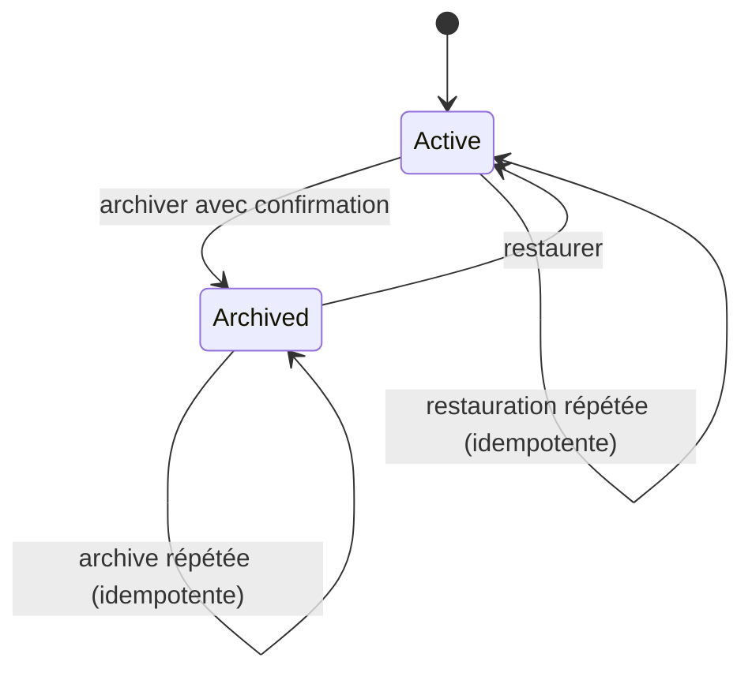
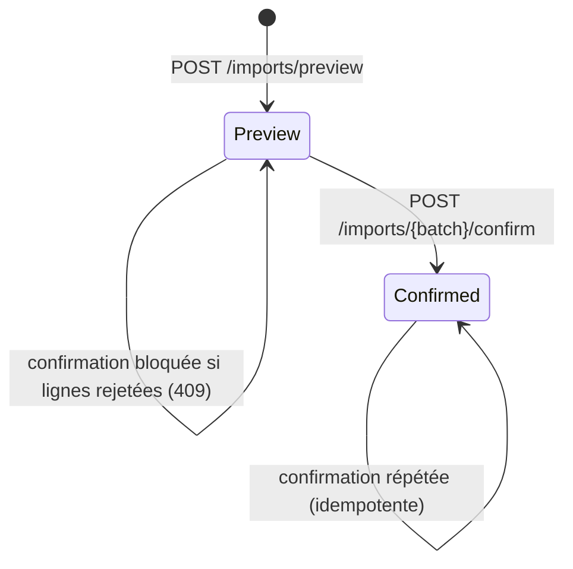
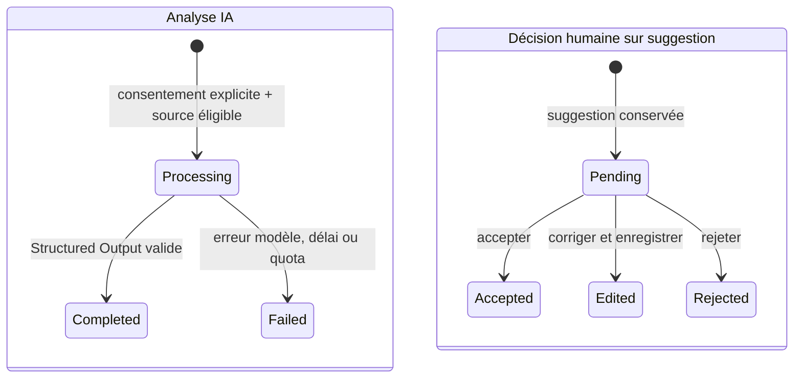
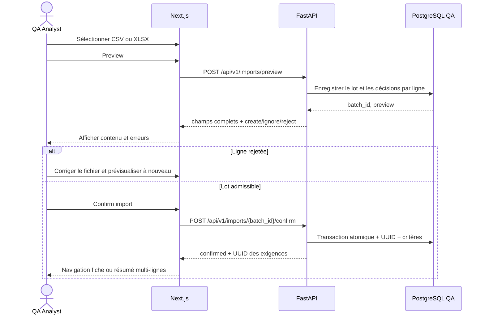
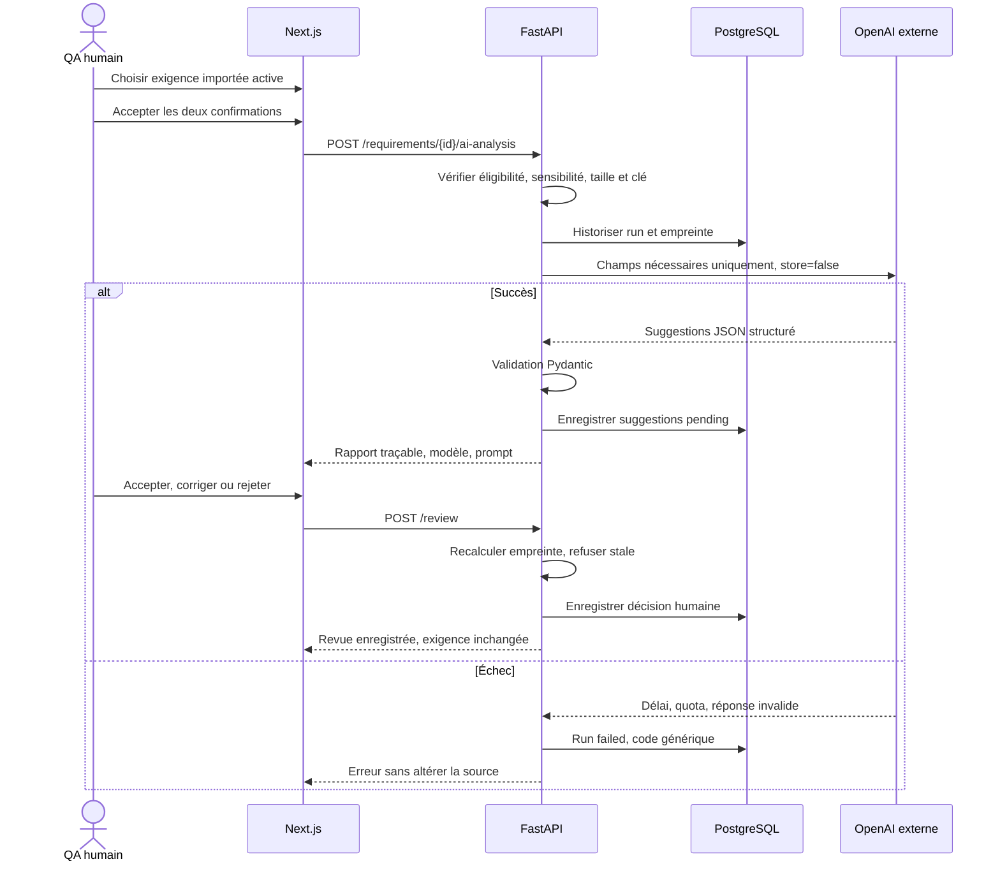

# Diagrammes des états et des parcours — Requirements Intelligence

**Périmètre :** comportements codés dans `backend/app/modules/requirements/application/lifecycle.py`, `backend/app/api/v1/imports.py`, `backend/app/api/v1/ai_analysis.py`, modèles PostgreSQL et frontend associé. Les diagrammes reflètent le code, pas des hypothèses de futur module.

## D-01 — États métier d'une exigence (QA-95 / FR-007)

```mermaid
stateDiagram-v2
    [*] --> Draft: création manuelle ou import confirmé
    Draft --> "In Review": demander revue
    "In Review" --> Ready: marquer prêt
    "In Review" --> Draft: retour correction
    Ready --> Draft: rouvrir
```

**Transitions autorisées :** Draft→In Review, In Review→Ready, In Review→Draft, Ready→Draft. Toute transition non décrite (y compris vers le même état) renvoie 409. `Ready` n'est pas une décision Go/No-Go ; l'historique persiste séparément.

## D-02 — Archivage orthogonal au cycle de vie (QA-97)



Le statut `Draft/In Review/Ready` ne change pas lors d'une archive/restauration. La fiche individuelle demeure consultable ; seuls le registre et la recherche par défaut masquent les archives.

## D-03 — Lot d'import (QA-87/98/99/100)



Le lot `Preview` est déjà persisté comme **rapport de staging**, mais les exigences ne le sont pas. Les lignes portent les décisions `create`, `ignore`, `reject` ; les lignes rejetées interdisent la confirmation. La prévisualisation complète montre les données avant validation ; une nouvelle analyse de fichier crée un **nouveau** lot.

## D-04 — Analyse et suggestion IA (QA-90)



`stale` est un **indicateur calculé** par comparaison d'empreinte du contenu actuel, pas un quatrième statut d'analyse. Une suggestion revue ne peut pas être revue une seconde fois. Une suggestion de test issue de QA-90 n'est **pas** encore un objet `TestCase` du futur module AI Test Design.

## D-05 — Séquence d'import (QA-87)



## D-06 — Séquence de revue OpenAI et décision humaine (QA-90)



**Important :** les diagrammes de Quality Gate Go/No-Go et de création d'objets TestCase seront ajoutés quand leurs services existeront ; les dessiner comme livrés induirait en erreur.
